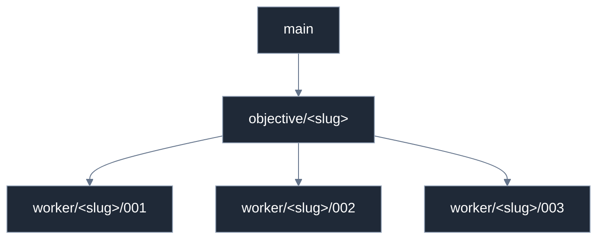

# Branch and worktree model

Work identity is the **objective and task**. The harness that happens to run the work is not
part of that identity.

Canonical policy: [`core/policies/git.md`](../../../core/policies/git.md). This page is the
engineering view of it.

---

## Branches



`main` stands for whatever `objective.base_branch` says.

- `<slug>` is the objective `id` (`^[a-z0-9][a-z0-9-]*$`).
- The worker suffix is the task's three-digit number, so `worker/auth/002` pairs
  unambiguously with `task-002.json`.
- Worker branches merge **into the integration branch**, never into `base_branch`. The
  integration branch is what gets delivered.
- The integration branch is cut from `base_branch` at objective start and recorded in
  `objective.json`.

**A worker never merges, rebases onto, or pulls `base_branch`.** Divergence is the
integrator's decision, taken once, at integration. A worker that merges main pollutes every
other worker's diff and makes the combined review unreadable.

## Worktrees

```text
.agent-worktrees/
└── <objective>/
    ├── integration/
    ├── task-001/
    ├── task-002/
    └── task-003/
```

A user-level equivalent outside the repository is equally valid and preferred when the
checkout must stay clean — `~/.agent-worktrees/<repo>/<objective>/task-001`. **Both layouts
are supported and resolution code must handle either.** `.agent-worktrees/` is gitignored.

In sequential mode, per-task worktrees may be skipped entirely: tasks commit one after
another directly onto the objective branch. The orchestrator says when it is doing that.

## Provider is metadata

Provider (`claude`, `codex`, `cursor`, `gemini`, `opencode`) is recorded in `task.provider`
and **nowhere else**. It must not appear in a branch name, a worktree path, or a state
directory name.

The old layout did the opposite — `.claude/.worktrees/…`, `.cursor/.worktrees/…`,
`.codex/.worktrees/…` — which made the harness part of the work's identity, so the same task
resumed under a different provider looked like different work. Provider may still appear in
a log line or debug label: that is annotation, not identity.

## Legacy worktrees are never orphaned

Worktree resolution (`resolve-worktree.sh` and everything that calls it) must:

1. **Recognize both shapes** — search the objective layout *and* the legacy platform layouts
   (`.claude/.worktrees/`, `.cursor/.worktrees/`, `.codex/.worktrees/`, and their user-level
   equivalents) when locating a worktree for a branch or task.
2. **Never orphan live work** — a legacy worktree with commits or uncommitted changes is not
   deleted, not moved out from under its session, and not "cleaned up" as stale.
3. **Provide a list command** enumerating every worktree in either layout, with branch,
   layout shape, and dirty state, so the whole picture is visible before any decision.
4. **Provide an opt-in migration command**, one worktree at a time, preserving uncommitted
   work and refusing a dirty tree without an explicit confirm flag. There is no automatic
   bulk rewrite and no destructive directory migration.
5. **Prefer new, accept old** — new work is created in the objective layout; work already
   living in the legacy layout continues there until the user migrates it.

Resolving a slug that already has a legacy worktree returns *that* worktree rather than
creating a parallel one.

The single-task session layout follows the same rules. Its root is configurable and defaults
to `~/.session-worktrees/<repo>/<slug>`, outside `~/.claude`. The old
`~/.claude/worktrees/<repo>/<slug>` root is recognised and never created, a live worktree
there is still the session's worktree, and `scripts/worktrees-migrate.sh` is the opt-in
mover for idle ones ([ADR 005](../decisions/005-session-worktree-root.md)).

## Hook automation is a capability, not an assumption

On Claude Code, `hooks/hooks.json` creates the worktree from the first prompt, copies
`.worktreeinclude` files, assigns a deterministic per-branch `DEV_PORT`, and installs
dependencies in the background. The registry records `worktree_isolation` as `native` there.

Everywhere else it is `emulated`: the skill runs `git worktree add` / `remove` itself, as
explicit steps. On Claude Desktop it is `unknown`, which means single checkout, serialized
tasks. Nothing in the workflow may *require* the hook path.

## Safety rules

- No force-push to `base_branch`, or to a branch another task is working on.
- The integrator does not rewrite worker branch history.
- Uncommitted work in any worktree is never discarded to make an operation succeed.
- Worktree removal requires a clean worktree, or explicit user authorization of the loss.

## Dependency installs multiply with agent count

Every worktree that triggers a background dependency install pays that cost again. With N
concurrent workers that is N installs. Keep the install conditional (skip when
`node_modules` already exists), keep it in the background, and prefer sequential mode when
the install dominates the actual work.

---

<p align="center"><a href="https://github.com/Tamircohen28">Have a Question?</a>&nbsp;·&nbsp;<a href="https://github.com/Tamircohen28/tamirs-superpowers/issues/new/choose">Open an Issue</a></p>
