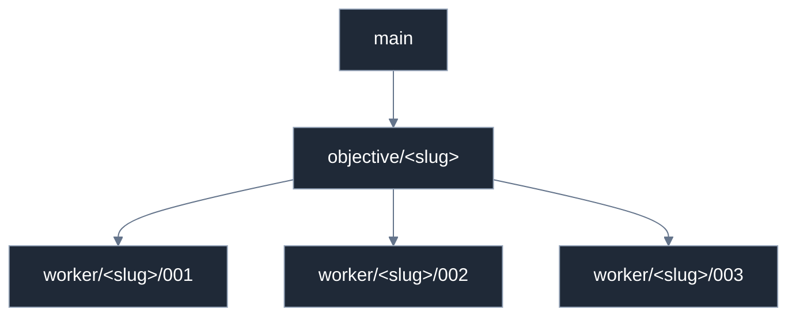

# Concepts

Six ideas explain everything else in this toolkit. Read this page once and the skills stop
looking like a pile of slash commands.

---

## 1. Objective vs task vs handoff

| Term | What it is | Ends at |
|---|---|---|
| **Objective** | The one thing *you* asked for. "Add authentication." | A pull request |
| **Task** | One unit of work inside it, with a declared write scope. | A commit |
| **Handoff** | The structured record a task leaves behind for whoever consumes it. | A JSON file |

An objective is decomposed into tasks whose write scopes are **disjoint** — two tasks that
may write the same file are not two tasks, they are one task or a dependency pair. Each
task's entire output is its handoff: what changed, which validation actually ran, what it
could not do, what it noticed on the way. The integrator reads handoffs, never reasoning.

State lives on disk, not in a service:

```text
.dev-files/objectives/<objective-id>/
├── objective.json      # the objective
├── plan.md             # the planner's rationale, for humans
├── tasks/task-001.json # one per task
├── handoffs/task-001.json
└── integration.json
```

Schemas: [`core/workflow/`](../../core/workflow/README.md). `.dev-files/` is gitignored by
default — it is scratch coordination state, rebuildable from `objective.json` plus the
branch graph. That is also why an interrupted objective can resume: see
[orchestration.md](orchestration.md#resuming-an-interrupted-objective).

---

## 2. Work unit ≠ delivery unit

**A task ends at commit + handoff. It does not open a pull request.**

This is the single most important behavioral rule here, and the one most likely to surprise
you if you used `/start-dev` before. A worker must not create a PR (not even a draft), must
not enable auto-merge, must not merge or rebase the base branch, and must not write outside
its scope.

Why: five tasks that each open their own PR give you five review fragments no one can judge
independently, five CI runs, and a merge order somebody has to babysit — and no point at
which the *combined* diff was ever reviewed. Composition bugs live exactly there.

So: **one objective = one PR**, by default. Multiple PRs are legitimate only for a reason on
the enumerated list in [`core/policies/delivery.md`](../../core/policies/delivery.md) —
independent deliverables, security isolation, deployment sequencing, your explicit request,
or a configured size threshold — and the reason gets recorded on the objective. "It felt
cleaner" is not on the list.

---

## 3. Role ≠ provider

A **role** is what the work needs done. A **provider** is which harness happens to do it.

| Roles | Providers |
|---|---|
| planner, orchestrator, implementer, test-engineer, reviewer, security-reviewer, performance-reviewer, debugger, integrator, research-agent | claude, codex, cursor, gemini, opencode |

Roles are defined once in [`core/roles/`](../../core/roles/README.md) and referenced by both
the agent definitions in [`agents/`](agents.md) and the skills. Provider is *metadata*:
it is recorded in `task.provider` and appears nowhere in a branch name, a worktree path, or
a state directory. The old layout did the opposite (`.claude/.worktrees/…`,
`.cursor/.worktrees/…`), which made the harness part of the work's identity — so the same
task resumed in a different tool looked like different work.

Default provider is `current`: whatever you are already running in. **Nothing here requires
a second AI subscription to complete an objective.**

---

## 4. Capabilities and honest degradation

Platforms disagree about subagents, hooks, statuslines, marketplaces, and structured
questions. Instead of assuming, the toolkit reads a registry:

[`core/capabilities/platforms.json`](../../core/capabilities/platforms.json) records a
status per platform per capability:

| Status | Meaning |
|---|---|
| `native` | The platform reads this repo's canonical files directly |
| `adapter` | The canonical form does not load, but a **generated** one does — built and drift-checked here, then consumed natively |
| `emulated` | Built out of lower-level primitives (shell + git) by the skill itself |
| `partial` | Works on some surfaces or some configurations |
| `unknown` | **Not measured by this repo.** Treated as unavailable — which is not the same as saying it fails |
| `unsupported` | A measured, confirmed absence |

Every entry that is not `native` carries a stated fallback. A skill that needs a missing
capability degrades along that fallback and *says so* — it never silently pretends. Which
is why the comparison table in [platform-differences.md](platform-differences.md) is full of
honest `unknown`s rather than optimistic checkmarks.

The two statuses people misread are `adapter` and `unknown`. `adapter` means the capability
**is available to you**, via a generated file — Gemini CLI's agents and skills both work this
way — and the only rule is never to hand-edit that file. `unknown` records that nobody
checked; turning it into "unsupported" would assert a failure that was never observed, which
is the exact dishonesty the registry exists to prevent.

---

## 5. Validation tiers 0–3

The old workflow validated everything in every worker, then validated it all again in CI.
Four tiers replace that. Every skill and script declares which tier it runs.

| Tier | Who | What runs | Goal |
|:--:|---|---|---|
| **0** | edit-time | cheap syntax (`jq empty`, `bash -n`), near-instant lint of the touched file | catch a typo before it costs a run |
| **1** | worker | tests relevant to the changed code, lint/typecheck scoped to `scope[]` — **never** the full suite | prove *this contribution* is sane |
| **2** | integration | full lint + typecheck, unit suite, objective-relevant integration tests, repo standards gate, combined-diff review | prove the workers **compose** |
| **3** | delivery / CI | independent CI, expensive cross-platform/build/security tests, release checks | final authority |

"The repository is green" is only a meaningful claim from Tier 2 onward — it is not knowable
from inside a single task, and paying for it in every task is what made the old workers slow.
Policy: [`core/policies/validation.md`](../../core/policies/validation.md).

Only commands that actually ran may be reported. A skipped tier is reported as skipped, with
a reason — never omitted, never reported as passing.

---

## 6. Branches and worktrees follow the work



`objective/<slug>` is the integration branch, one per objective; each `worker/<slug>/NNN` is one per task, numbered to match `task-NNN.json`.

Worker branches merge **into the integration branch**, never into `main`. Conflicts are
resolved once, by the integrator, at integration — a worker that merges `main` pollutes
every other worker's diff.

Worktrees mirror that shape under `.agent-worktrees/<objective>/<task-id>/` (or a user-level
equivalent outside the repo). Legacy platform-shaped worktrees are still recognized and are
never orphaned or bulk-migrated; migration is opt-in, one worktree at a time. Policy:
[`core/policies/git.md`](../../core/policies/git.md).

---

## Where to go next

- [Orchestration](orchestration.md) — the flow end to end, including the sequential path
- [Skills](skills.md) — what each skill does and when it fires
- [Agents](agents.md) — the role definitions behind the agents
- [Platform differences](platform-differences.md) — what your platform can actually do

---

<p align="center"><a href="https://github.com/Tamircohen28">Have a Question?</a>&nbsp;·&nbsp;<a href="https://github.com/Tamircohen28/tamirs-superpowers/issues/new/choose">Open an Issue</a></p>
