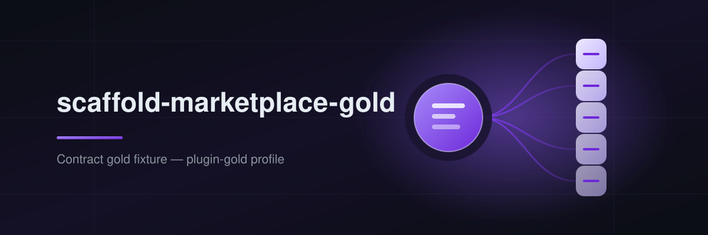

<p align="center">
  
</p>

<p align="center">
  <a href="https://github.com/Tamircohen28"></a>
  <a href="https://github.com/TamirCohen28/scaffold-marketplace-gold/actions/workflows/ci.yml"></a>
  <a href="LICENSE"></a>
  <a href=".claude-plugin/marketplace.json"></a>
</p>

<p align="center">
  <a href="docs/engineering/build-and-release/platform-targets.json"></a>
  <a href="docs/engineering/build-and-release/platform-targets.json"></a>
  <a href="docs/engineering/build-and-release/platform-targets.json"></a>
  <a href="docs/engineering/build-and-release/platform-targets.json"></a>
  <a href="docs/engineering/build-and-release/platform-targets.json"></a>
</p>

# scaffold-marketplace-gold

Contract gold fixture for marketplace-gold profile validation.

A **plugin marketplace**: one catalog of plugins, published in the manifest each platform
reads. Users add the marketplace once and install plugins from it by name.

## Catalog

| Plugin | Description | Source | Claude Code | Cursor | Codex | OpenCode |
|---|---|---|---|---|---|---|
| `scaffold-marketplace-gold-starter` | Starter plugin shipped with this marketplace | `./plugins/scaffold-marketplace-gold-starter` | yes | yes | yes | no |

OpenCode has no marketplace concept: a plugin reaches OpenCode only when it is also
published to npm as an OpenCode plugin module and named in a user's `opencode.json`
`plugin` array. The column is honest, not a gap to fix here.

## Prerequisites

- `jq` (manifest checks)
- Claude Code 2.x for `claude plugin validate` (optional; the jq checks run without it)

## Quick Start

### Claude Code

```text
/plugin marketplace add TamirCohen28/scaffold-marketplace-gold
/plugin install scaffold-marketplace-gold-starter@scaffold-marketplace-gold
```

Claude Desktop installs from the same listing.

### Cursor

Cursor reads `.cursor-plugin/marketplace.json` from this repository. Submit the repo at
<https://cursor.com/marketplace/publish>, or install a plugin from a git URL with the
Cursor CLI: `agent plugin marketplace add https://github.com/TamirCohen28/scaffold-marketplace-gold`.

### Codex

```text
codex plugin marketplace add TamirCohen28/scaffold-marketplace-gold
```

Codex reads `.agents/plugins/marketplace.json` (and `.claude-plugin/marketplace.json` as a
legacy-compatible catalog). Install from the ChatGPT desktop app, or
`codex plugin add scaffold-marketplace-gold-starter@scaffold-marketplace-gold` on the CLI.

### OpenCode

No marketplace. See the Catalog column above.

## Maintaining the catalog

```bash
make validate     # every manifest, cross-checked; claude plugin validate when available
```

How to add a plugin (local directory, GitHub repo, npm package) and what each platform
needs from its entry: [docs/user/catalog.md](docs/user/catalog.md).

## Documentation

See [docs/README.md](docs/README.md).

## Contributing

See [docs/CONTRIBUTING.md](docs/CONTRIBUTING.md).

---

MIT © [Tamir Cohen](https://github.com/Tamircohen28)
